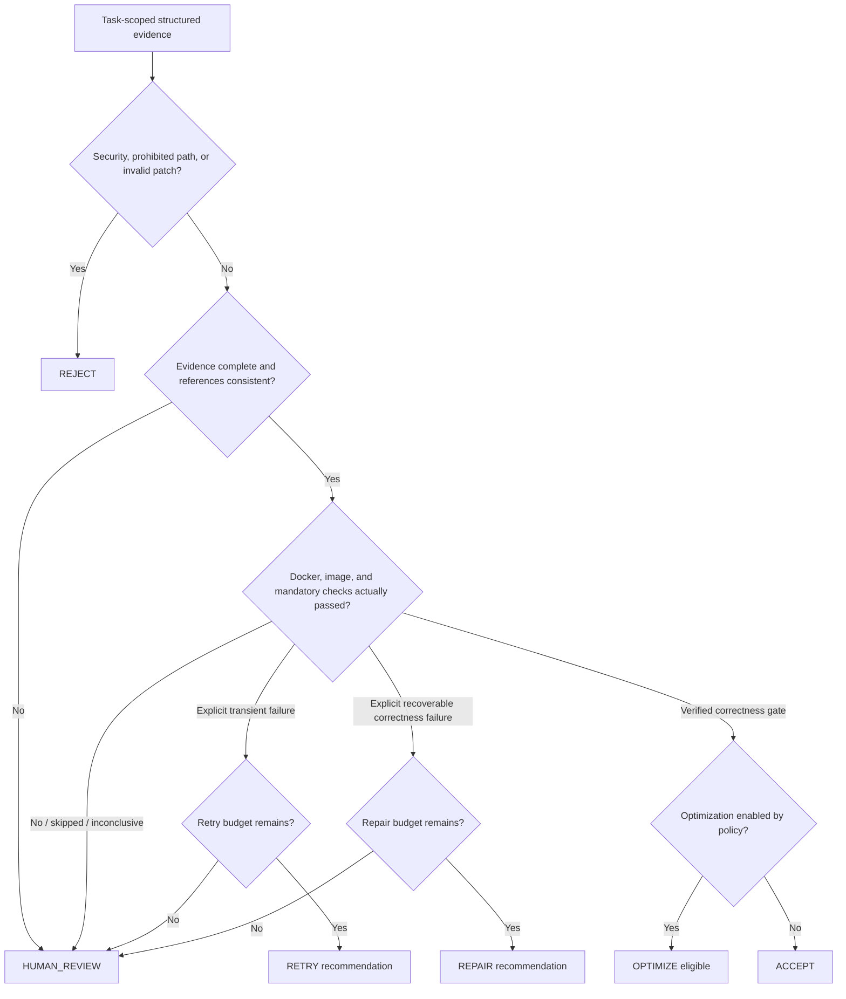

# ASEP architecture

## Milestones 2.1 and 3.0 scope

The implementation supports issue intake, repository inspection, isolated patch creation,
evidence-backed verification, and deterministic VGRO decisions. It does not execute
repairs or retries, run benchmarks, persist across process restarts, or deploy.

## Components

- **API:** Pydantic request/response models and thin FastAPI routes. An `AppServices` container is created at application startup and supplied through request dependencies.
- **Task/evidence store:** Thread-safe in-memory storage keyed by UUID-based task IDs. Tasks, worktree records, patch artifacts, and verification reports cannot be stored under a different task ID.
- **Worktree manager:** Rejects dirty source repositories, records the main repository and base SHA, and creates a detached per-task worktree under a private managed root. It registers worktrees without checkout and materializes Git objects without hooks or filters. Cleanup only removes a registered, clean worktree identified by its stored record; it never uses force removal.
- **Patch engine:** Obtains a structured proposal from the mock provider; validates the entire proposal; uses directory file descriptors and no-follow opens for patch writes; and records the complete Git diff, changed paths, file hashes, and patch hash.
- **Verification engine:** Collects Git integrity and path evidence, then invokes pytest, Ruff, and mypy only through the configured Docker sandbox service. Git metadata commands run on the host; repository test/lint/type-check code does not.
- **Docker sandbox:** Uses a locally built, digest-pinned verification image, network isolation, a read-only container root, a read/write mount of only the task worktree, Fedora SELinux relabeling, non-root UID, resource caps, timeouts, output capture, and forced container cleanup.
- **VGRO domain:** `app/vgro/decision_engine.py` evaluates typed task, worktree, patch, verification, policy-violation, and recovery-attempt evidence. It has no FastAPI, Docker, Git, or AI-provider dependency. The API supplies evidence from the task-scoped store and persists the resulting decision.
- **Recovery tracker:** A thread-safe in-memory tracker records bounded RETRY/REPAIR attempts and remaining budgets. It only records attempts; it does not start execution.

## VGRO decision flow

Decisions are deterministic for identical evidence, policy, and attempt history. The
decision result includes policy version, machine-readable reason codes, explanatory
reasons, stable evidence references, remaining budgets, and whether an attempt or
human approval is permitted/required.

## Default VGRO policy

The versioned `VGROPolicy` defaults to one retry and one repair attempt, optimization
disabled, and the mandatory check IDs `changed-paths`, `patch-integrity`,
`docker-pytest`, `docker-ruff`, and `docker-mypy`. Common environment files, secret
directories, private keys, and PEM files are prohibited. Mandatory security failures
are hard rejections. Missing or inconclusive evidence, unavailable Docker/image,
skipped checks, and unknown failure classifications require human review.

Failure checks are recoverable or transient only when their structured
`failure_classification` explicitly says so. The verifier defaults this field to
`UNKNOWN`; ordinary test failures are therefore not automatically repairable.

## Decision meanings

- `ACCEPT`: all evidence and mandatory correctness checks passed. This is not a merge,
  release, or production-deployment approval.
- `OPTIMIZE`: the correctness gate passed and policy explicitly enabled optimization.
  Benchmarking and optimization execution are not implemented.
- `REPAIR`: evidence explicitly classified a failed correctness check as recoverable
  and repair budget remains.
- `RETRY`: evidence explicitly classified a failure as transient infrastructure and
  retry budget remains.
- `REJECT`: patch integrity, path, or security policy evidence requires a hard stop.
- `HUMAN_REVIEW`: evidence is missing, ambiguous, blocked, skipped, inconsistent, or
  has exhausted the applicable budget.

## Verification state

Individual mandatory checks report `PASS`, `FAIL`, `ERROR`, or `SKIPPED`. The overall report is:

- `VERIFIED`: every mandatory check ran and passed.
- `FAILED`: an executed mandatory check failed.
- `INCOMPLETE`: mandatory evidence had an execution error or was skipped.
- `BLOCKED`: Docker or the required local verification image was unavailable.

No skipped or inconclusive check can make a task verified.

## API task lifecycle

`CREATED -> WORKTREE_READY -> PATCH_GENERATED -> PATCH_APPLIED -> VERIFYING -> VERIFIED|FAILED|INCOMPLETE|BLOCKED`

Patch proposal errors produce `REJECTED` or `FAILED`, never a successful task status. Responses omit absolute repository/worktree paths. Task evidence includes the worktree base SHA and repository name without exposing the host directory.

## Known limitations

- Task and evidence storage is in memory and is lost on process restart.
- The mock provider emits deterministic demonstration proposals; it is not repository-aware code synthesis.
- Verification results depend on the exact locally built image tag. ASEP will not pull or substitute an image when it is missing.
- Docker daemon access remains a host trust boundary. The platform controls container restrictions but cannot contain a compromised Docker daemon or host kernel.
- The task store retains only the latest VGRO decision in memory; restart loses the
  decision and recovery-attempt history.
- Recovery decisions are recommendations only. Retry/repair execution, benchmark
  collection, and optimization are not implemented.
- No patch commits, merges, push, release, or automatic deployment are implemented.
